<div align="center">
  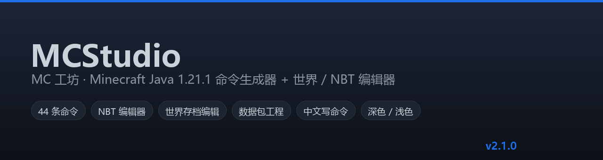
  <br><br>
  <a href="https://github.com/Aa5000345/mc-cmd-gen/releases/latest"></a>
  
  
  
  
  
</div>

**MCStudio（MC 工坊）** 是面向 Minecraft Java **1.21.1** 的桌面工具：左边把 44 条命令
图形化拼出来，中间直接编辑世界存档与 NBT 文件，右边看结果 ——
两边通过**结构化对象**互推（不是复制粘贴文本），所有写盘都先备份、可撤销。

- 🎯 **不用记语法**：`/give`、`/summon`、`/execute`、`/setblock` … 表单化 + 实时校验，
  物品 / 方块 / 实体都能用中文名搜索。
- 🧭 **不会迷路**：首页任务卡、`Ctrl+K` 命令面板、底部「下一步」引导条，
  每个面板底部都有明确的主行动按钮。
- 🛡 **不会改坏存档**：默认只读，解除锁定后每次写入都是
  「备份 → 校验 → 差异预览 → 确认 → 原子替换」，还能**撤销并回滚磁盘**。

---

## 目录

- [快速上手](#快速上手)｜[界面导览](#界面导览)｜[核心功能](#核心功能)
- [世界编辑器](#世界编辑器)｜[安装与运行](#安装与运行)｜[快捷键](#快捷键)
- [架构](#架构)｜[命令行工具](#命令行工具无需-gui)｜[数据与配置](#数据与配置)
- [测试与质量](#测试与质量)｜[常见问题](#常见问题)｜[已知限制](#已知限制)

---

## 快速上手

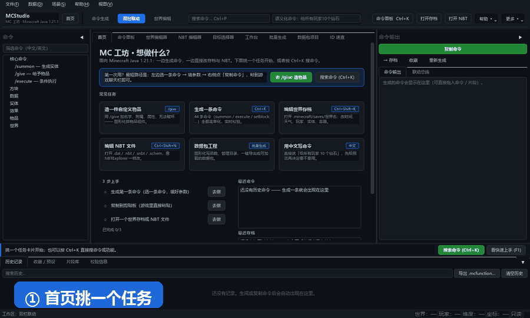

<div align="center"><sub>首页挑任务 → <code>Ctrl+K</code> 搜命令 → 填参数 → 点「复制命令」→ 到游戏聊天栏粘贴</sub></div>

### 三种开始方式

| 方式 | 适合 | 步骤 |
|---|---|---|
| **绿色版**（推荐） | 只想用，不想装环境 | 到 [Releases](https://github.com/Aa5000345/mc-cmd-gen/releases/latest) 下载 `MCStudio-<版本>-win64.zip` → 解压 → 双击 `MCStudio.exe` |
| **源码运行** | 想改代码 / 用 macOS、Linux | `pip install -r requirements.txt` → `python main.py` |
| **命令行** | 脚本、批处理、CI | `python mcgen.py --help`（44 条命令 + 世界编辑全都能走 CLI） |

> 首次启动会在 `%LOCALAPPDATA%\mcstudio\`（macOS/Linux 为系统惯例路径）建立数据目录；
> 如果想放 U 盘里随身带，设环境变量 `MCSTUDIO_DATA_DIR` 指向任意目录即可。
> 之前用过旧名 **MCCmdGen** 的话，旧数据会自动复制过来，旧目录原样保留。

---

## 界面导览

### 首页：一眼知道能做什么

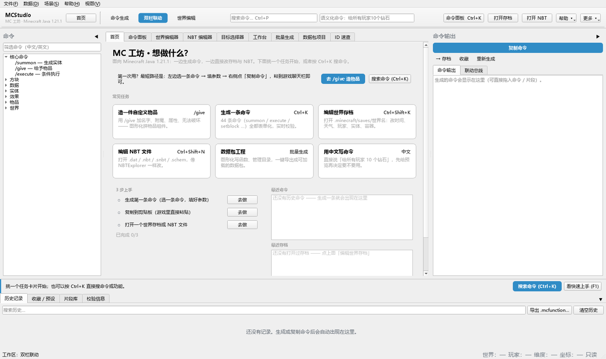

六张任务卡（造物品 / 生成命令 / 编辑存档 / 编辑 NBT / 数据包 / 中文写命令）
+ 会随操作打勾的「3 步上手」清单 + 最近命令与最近存档。
首屏不再是「一个世界都没打开」的空白编辑器。

### 命令面板 `Ctrl+K`：不用记路径

<table>
<tr>
<td width="50%">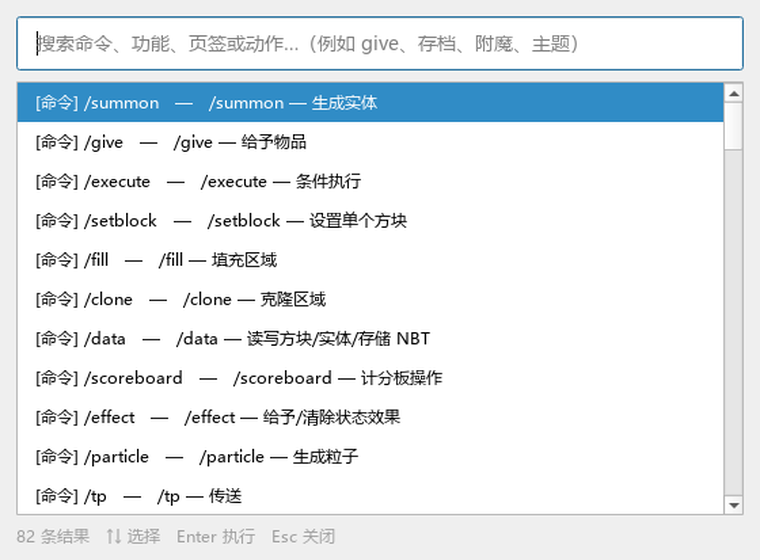</td>
<td width="50%">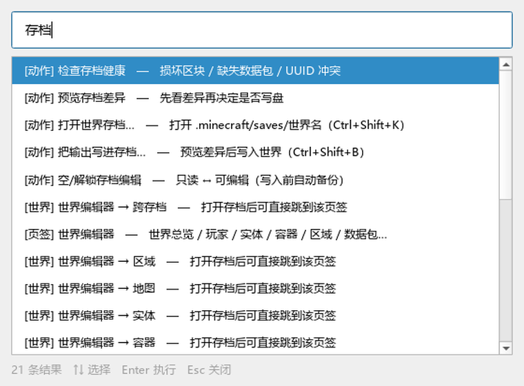</td>
</tr>
<tr>
<td align="center"><sub>全部 44 条命令 / 页签 / 动作都在里面</sub></td>
<td align="center"><sub>中文关键词也能搜（「存档」「附魔」「主题」）</sub></td>
</tr>
</table>

### 命令面板：填参数时始终知道下一步

<table>
<tr>
<td width="50%">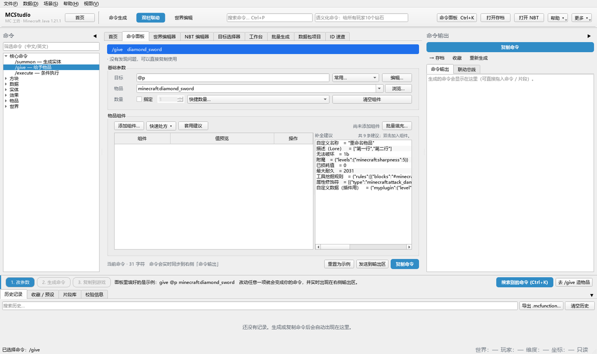</td>
<td width="50%">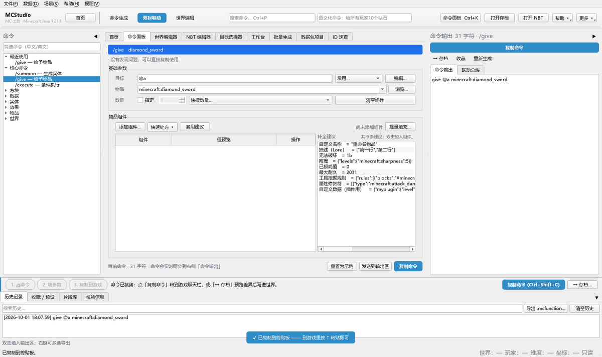</td>
</tr>
<tr>
<td align="center"><sub><code>/give</code>：物品组件表格 + 补全建议</sub></td>
<td align="center"><sub>命令实时出现在输出区，复制后有浮层确认</sub></td>
</tr>
</table>

窗口底部常驻**上下文引导条**：步骤胶囊 + 一句话 + 此刻该点的按钮，
随状态变化（空输出 / 有命令 / 存档未打开 / 只读 / 有未应用修改 …）：

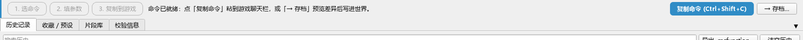

### 其他面板

<table>
<tr>
<td width="50%">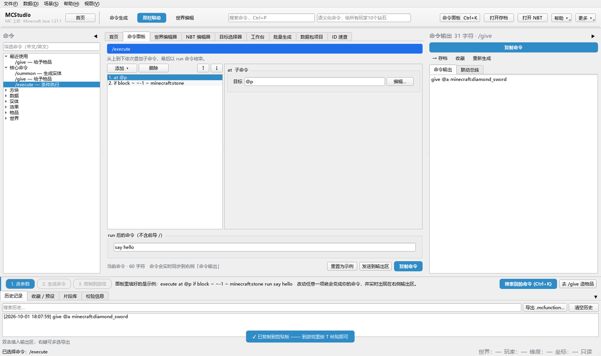</td>
<td width="50%">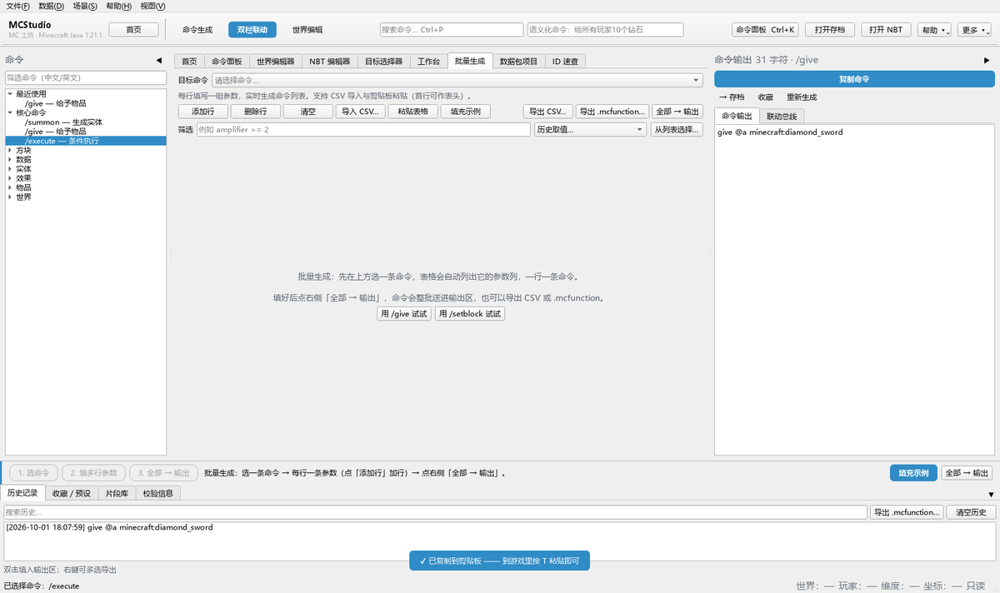</td>
</tr>
<tr>
<td align="center"><sub><code>/execute</code>：条件链式编辑器</sub></td>
<td align="center"><sub>批量生成：一行一条参数，整批送输出</sub></td>
</tr>
<tr>
<td width="50%">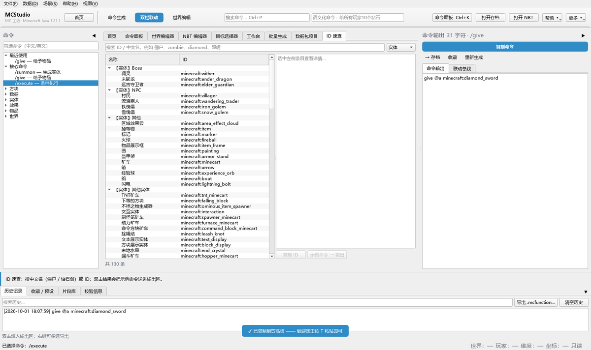</td>
<td width="50%">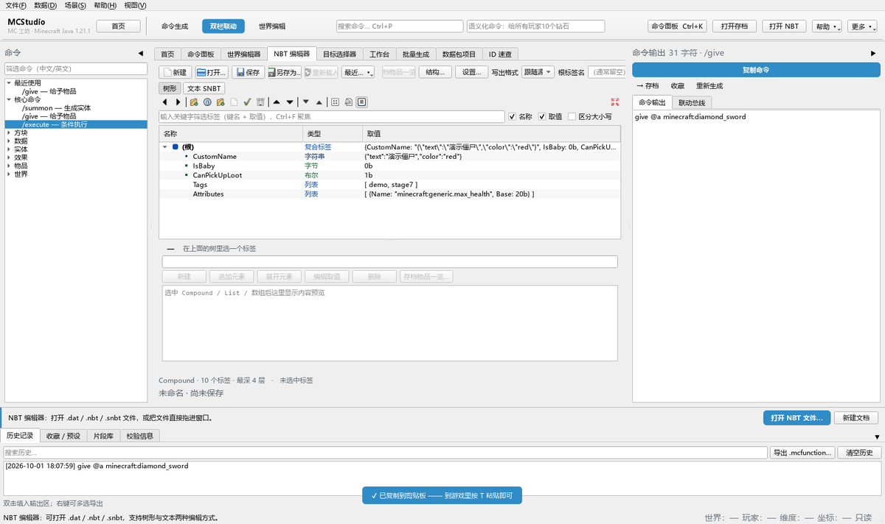</td>
</tr>
<tr>
<td align="center"><sub>ID 速查：实体 / 物品 / 方块 / 组件</sub></td>
<td align="center"><sub>NBT 编辑器：交互对标 NBTExplorer</sub></td>
</tr>
</table>

### 深色 / 浅色主题

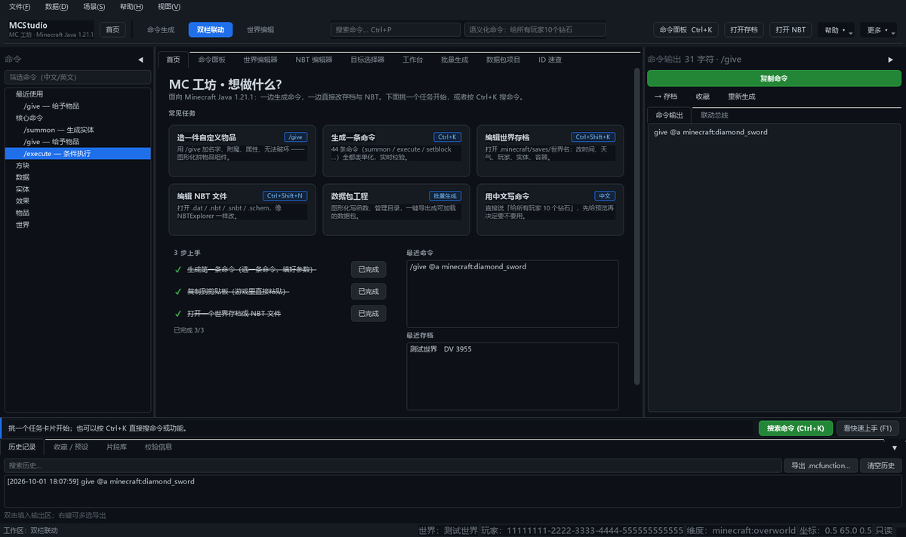

---

## 核心功能

| 模块 | 能做什么 |
|---|---|
| **命令生成** | 44 条命令（3 条手写核心 + 41 条 Schema 驱动）：实体 / 物品 / 方块 / 坐标 / 条件链 / 目标选择器全图形化，SNBT 实时校验并定位错误 |
| **物品组件工坊** | 1.21 物品组件（自定义名称、Lore、附魔、属性、无法破坏…）+ 一键「快速处方」，批量套用到玩家或容器 |
| **世界存档编辑** | `level.dat` / `playerdata` / 实体 / 容器 / `map_*.dat` / 区域索引 / 数据包，11 个编辑页签 |
| **NBT 文件编辑** | `.dat` / `.dat_old` / `.nbt` / `.snbt` / `.schem`：三列树、就地编辑、数组编辑器、查找替换、拖放改层级、撤销重做，**保持原压缩格式与根标签名** |
| **数据包工程** | 图形化写函数 / 进度 / 战利品表 / 谓词 / 函数标签，一键导出成游戏能读的数据包 |
| **可视化编排** | 坐标 / 区块选择器 + 方块调色板，把选区导出成 `/setblock`、`/fill`、`.schem` 或蓝图 |
| **命令 ↔ 存档桥接** | 两侧交换**结构化对象**：物品卡片「→ /give 面板」、实体卡片「→ /summon 面板」、存档物品「→ 批量应用」 |
| **中文写命令** | 「给所有玩家 10 个钻石」「把时间设置为夜晚」→ 先给 diff 预览，确认后才写 |
| **版本迁移** | 自动识别命令所属版本（1.20.4 → 1.21.1），迁移后弹差异对照 |
| **全量注册表** | 物品 1333 / 方块 1059 / 实体 130 / 附魔 43，中文名取自官方语言文件 |

<details>
<summary><b>用 <code>/give</code> 造一件神装（展开看步骤）</b></summary>

1. 左侧命令树选 `/give`（或按 `Ctrl+G`）；
2. **目标**：填 `@a`，或点「编辑…」用图形化目标选择器；
3. **物品**：下拉里按 ID 或中文名搜索（`diamond_sword` / 钻石剑），会自动补 `minecraft:`；
4. **数量**：勾「指定」填数字，或从「快捷数量…」选 1/8/16/32/64/100；
5. **组件**：「添加组件…」按分组多选；表格双击编辑取值（附魔专用编辑器、布尔/枚举下拉、长值走 SNBT 编辑器）；
6. **快速处方**：一键套用「锋利 V 神剑」「无法破坏的效率镐」等整套组件；
7. 右侧输出区实时出现命令 → 点「复制命令」，到游戏里 `T` 粘贴。

> 1.21 起物品 NBT（`{display:{Name:…}}`）已不可用；如果粘贴了旧写法，
> 解析时会直接提示改用物品组件，也可以用「数据 → 迁移命令…」自动转换。
</details>

<details>
<summary><b>NBT 文件编辑器（展开看能力）</b></summary>

- 打开：`Ctrl+O`，或把文件**直接拖进窗口**；支持 `.dat` / `.dat_old` / `.nbt` / `.snbt`
  / `.schem` / `.schematic`；工具条「最近打开 ▾」记着最近 12 个文件。
- 保存：`Ctrl+S` 按**原压缩格式**（未压缩 / gzip / zlib）与原根标签名写回，
  不会把 `level.dat` 压成 gzip 让游戏读不出来；`Ctrl+Shift+S` 另存为。
- 编辑：三列树（名称 / 类型 / 取值）、标量就地编辑、按类型弹编辑器、
  数组编辑器、详情面板（路径 / 类型 / hex dump）、筛选高亮、多选复制粘贴、
  拖放改层级、查找替换、撤销重做。
- 联动：实体「→ /summon 面板」、物品「→ /give 面板」、标签「复制为 SNBT / /data 命令」。
</details>

---

## 世界编辑器

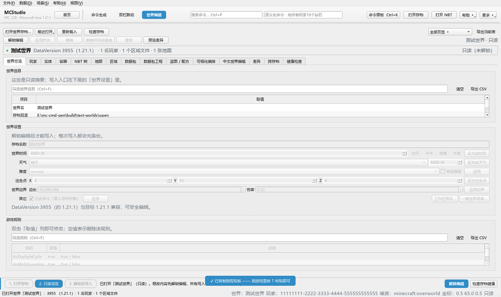

### 没打开存档时，先告诉你去哪打开

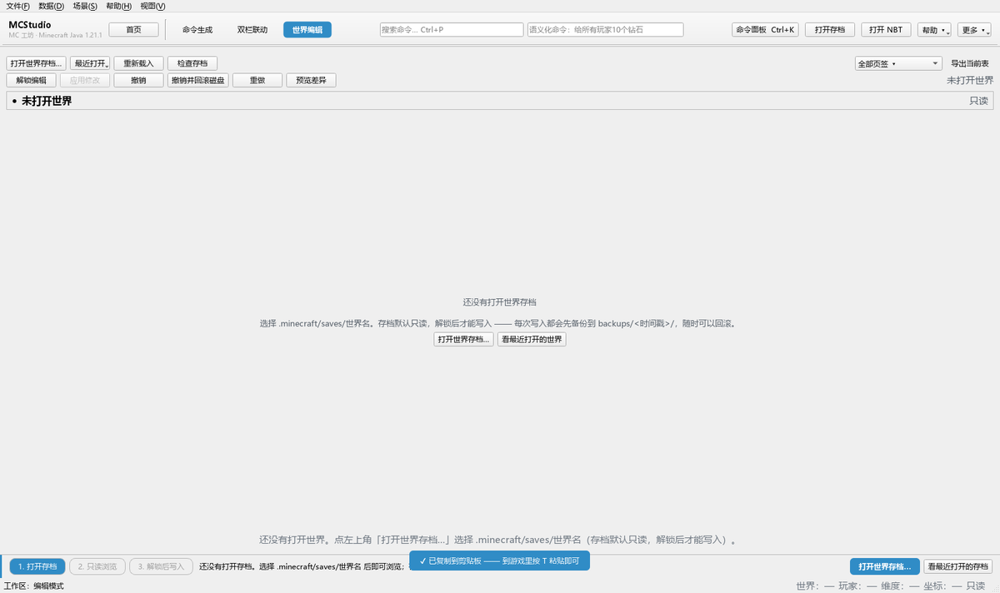

15 个页签在没打开存档时会收起来，取而代之的是一块引导页（「打开世界存档…」
「看最近打开的世界」）；页签太多时用工具条上的**「全部页签 ▾」**直接跳。

### 写入流程（默认只读，一步都不省）

```text
打开存档（只读） → 编辑表格（内存模型） → 「预览差异」
      → 确认 → 自动备份 backups/<时间戳>/ → 校验 → 原子替换 → 记撤销点
```

- 会写存档的入口在只读时**统一置灰**，鼠标停上去会说明「只读模式：先点『解锁编辑』」；
- 创建快照 / 导出 CSV 这类**只读也安全**的操作不受限制（先备份再解锁是合理顺序）；
- 写入失败也会告诉你备份在哪；「**撤销并回滚磁盘**」用这次写入前的备份把文件一起退回去。

<details>
<summary><b>15 个编辑页签分别在做什么</b></summary>

| 页签 | 内容 |
|---|---|
| 世界总览 | 只读摘要 + 时间 / 天气 / 难度 / 出生点 / 边界 / 允许命令 / 存档名 + 游戏规则 |
| 玩家 | `playerdata` 列表、字段编辑、背包卡片、一键塞满物品 |
| 实体 | 实体列表（读 / 复制 / `/summon` / 送联动总线） |
| 容器 | 箱子 / 桶 / 潜影盒 / 熔炉等方块实体内容 |
| NBT 树 | 完整 NBT 树只读视图 + 路径定位 / 复制 / 送总线 |
| 地图 | `map_*.dat` 的比例 / 锁定 / 追踪 / 中心 / 颜色 |
| 区域 | `region/*.mca` 区块索引（懒加载），可导出坐标列表 / `forceload` 函数 |
| 数据包 | 存档 `datapacks/` 内容浏览与函数导出 |
| 数据包工程 | 图形化写函数 / 进度 / 战利品表 / 谓词 / 函数标签 |
| 蓝图 / 配方 | 结构模板导出（`.nbt` / `.schem`）+ 物品组件配方工坊 |
| 可视化编排 | 坐标 / 区块选择器 + 方块调色板 → 命令或蓝图 |
| 中文世界编辑 | 自然语言 → 操作 → 差异 → 应用 |
| 差异 | 事务差异、备份列表、回滚 |
| 跨存档 | 从另一个存档搬运玩家数据 / 进度 / 地图（后台线程，带进度与取消） |
| 健康检查 | 损坏 / 越界区块、缺失数据包、版本不匹配、超大 NBT、UUID 冲突 |
</details>

<details>
<summary><b>区域文件写入与多区块批量替换（实验功能）</b></summary>

- 只支持**等长或更短**的原地替换，不会新建 / 移动区块、不扩容扇区；
- 批量替换两步走：① 全量 dry-run（列出「可写 / 跳过 + 原因」）→
  ② 确认后每个区域文件只备份一次，逐区块原子替换 + 写后自检；
- 整个过程跑在**后台线程**，有进度条和「取消」；取消时会明确告知
  「已写入的区块不会回滚，请查 `backups/`」；
- 能不动存档时建议导出 `.mcfunction` 让游戏自己执行。
</details>

<details>
<summary><b>模组存档与兼容性</b></summary>

- 识别 Forge / NeoForge 的 `fml` / `neoforge` 标签，只读展示、安全跳过；
- DataVersion 与目标版本不符时会给出兼容性提示，`read_only` 级别的差异会直接拦下写入；
- 建议写入前先关闭游戏，避免游戏把内存里的旧数据写回磁盘。
</details>

### 数据包工程：图形化写函数

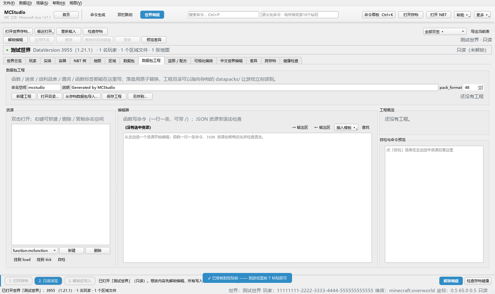

函数 / 进度 / 战利品表 / 谓词 / 函数标签都能在界面里写，落盘用原子替换，
工程目录可以直接指向存档的 `datapacks/` 让游戏立刻读到。

---

## 安装与运行

### 1. 绿色版（Windows，推荐）

到 [Releases](https://github.com/Aa5000345/mc-cmd-gen/releases/latest) 下载
`MCStudio-<版本>-win64.zip`（约 52 MB），解压后双击 `MCStudio.exe`。
**不需要安装 Python**，也不写注册表。

启动不来时用它自带的诊断：

```bat
set MCSTUDIO_SELFTEST=1
MCStudio.exe
```

会逐条打印「数据目录 / 内置数据 / 命令注册表 / nbtlib / sqlite3 / Qt / 主窗口」
的检查结果，哪一步缺文件一眼就能看出来。

### 2. 源码运行

```bash
git clone https://github.com/Aa5000345/mc-cmd-gen.git
cd mc-cmd-gen
pip install -r requirements.txt      # 或 pip install -e .
python main.py                       # Windows 也可以双击 run.bat
```

需要 Python 3.10+；依赖只有 `PySide6` 与 `nbtlib`。

### 3. 自己打包发行版

```bash
python tools/build_release.py            # → dist/MCStudio/ 与 dist/MCStudio-<版本>-win64.zip
python tools/build_release.py --console  # 保留控制台窗口，排查启动问题用
```

---

## 快捷键

| 快捷键 | 作用 | | 快捷键 | 作用 |
|---|---|---|---|---|
| `Ctrl+K` | 命令面板（搜命令 / 功能 / 页签） | | `Ctrl+Shift+K` | 打开世界存档 |
| `F1` | 快速上手向导 | | `Ctrl+Shift+N` | 打开 NBT / `.dat` 文件 |
| `Shift+F1` / `Ctrl+/` | 快捷键一览 | | `Ctrl+Shift+M` | 新建 NBT 文档 |
| `Ctrl+Shift+H` | 回到首页 | | `Ctrl+S` / `Ctrl+Shift+S` | 保存 / 另存 NBT |
| `Ctrl+P` | 聚焦「查找命令」 | | `Ctrl+Shift+B` | 输出 → 存档（联动总线） |
| `Ctrl+R` | 重新生成当前命令 | | `Ctrl+Shift+F` | 收藏输出命令 |
| `Ctrl+O` | 聚焦输出区 | | `Ctrl+G` | 跳到 `/give` |
| `Ctrl+Shift+C` | 复制输出命令 | | `Ctrl+Shift+D` | 编辑器独立成窗口 |
| `Ctrl+1..9` | 切换命令面板 | | `Ctrl+Shift+1/2/3` | 命令 / 编辑 / 双栏 |
| `F5` | 校验当前命令 | | `Ctrl+Shift+O` | 折叠 / 展开输出区 |

---

## 架构

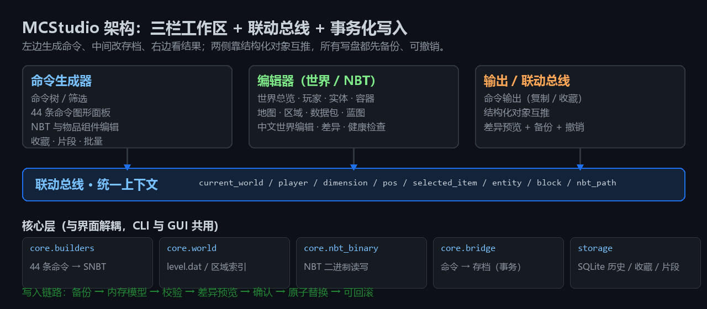

- **界面与核心解耦**：`app/core/**` 不依赖 Qt，所以 GUI 与命令行（`mcgen.py`）
  共用同一套 Builder、存档读写与桥接逻辑；
- **联动总线**：两侧交换结构化对象（`ItemStack` / `EntityData` / 坐标 / NBT 路径），
  统一上下文（当前世界 / 玩家 / 维度 / 坐标 / 选中物品…）显示在状态栏与总线抽屉；
- **写入必须走事务**：`WorldSession` 的 `baseline`（写盘基准）+ `WorldTransaction`
  负责备份、校验、原子替换、撤销点与日志，界面只是它的调用方。

<details>
<summary><b>目录结构</b></summary>

```text
mc-cmd-gen/
├── main.py                     GUI 入口（含 MCSTUDIO_SELFTEST=1 自检）
├── mcgen.py / mcstudio.py      命令行入口（两者等价）
├── app/
│   ├── branding.py             品牌与版本（窗口标题、数据目录名…）
│   ├── migration.py            旧数据目录迁移
│   ├── core/                   与界面无关的核心层
│   │   ├── builders/           44 条命令的 Builder（3 手写 + 41 Schema 驱动）
│   │   ├── nbt_binary/         NBT 二进制读写（保持压缩格式与根标签名）
│   │   ├── nlp/                中文语义解析（patterns.json）
│   │   ├── bridge.py           命令 ↔ 存档（结构化对象 + 事务执行器）
│   │   ├── world.py            level.dat / 区域文件 / 玩家 / 容器 / 地图
│   │   ├── world_session.py    写盘基准、事务、撤销栈、日志
│   │   ├── datapack*.py        数据包工程与导出
│   │   ├── snbt.py             SNBT 解析 / 序列化
│   │   └── item_components.py  1.21 物品组件引擎
│   ├── data/builtin/           内置注册表（物品 / 方块 / 实体 / 附魔 / 命令 schema）
│   ├── storage/                SQLite（历史 / 收藏 / 片段 / 草稿 / 世界索引缓存）
│   └── ui/
│       ├── shell/              2.1 新增：首页 / 导航条 / 命令面板 / 引导条
│       ├── panels.py           命令面板与底部面板
│       ├── world_panel.py      世界编辑器外壳（含只读门禁）
│       ├── world_tabs_*.py     15 个编辑页签
│       ├── widgets/            NBT 树、物品选择器、目标选择器等
│       └── dialogs/            设置 / 结构 / 物品一览 / 快捷键…
├── tools/                      fake_world / 截图 / 冒烟 / 打包脚本
├── tests/                      871 条测试
└── docs/                       设计文档与 README 配图
```
</details>

---

## 命令行工具（无需 GUI）

`mcgen.py` 与 `mcstudio.py` 完全等价，GUI 能做的事基本都有对应子命令：

```bash
# 生成命令
python mcstudio.py list                                  # 列出全部命令
python mcstudio.py give --item diamond_sword -c 'minecraft:custom_name="神剑"'
python mcstudio.py run summon minecraft:zombie ~ ~ ~     # 任意命令走 schema

# 世界存档（默认 dry-run，加 --apply 才写盘；写入走事务并自动备份）
python mcstudio.py world info "…/saves/世界" --json
python mcstudio.py world edit "…/saves/世界" DayTime=1000
python mcstudio.py world edit "…/saves/世界" GameRules.keepInventory=true --apply
python mcstudio.py world health "…/saves/世界"
python mcstudio.py world commands "…/saves/世界" -o items.mcfunction
python mcstudio.py world nlp "…/saves/世界" "把时间设置为夜晚"
python mcstudio.py world presets "…/saves/世界" --use creative_sandbox --apply
```

<details>
<summary><b>更多子命令（批量 / 区域 / 数据包 / 编排）</b></summary>

```bash
# CSV 批量生成
python mcstudio.py batch --command give --csv rows.csv --out commands.mcfunction

# 区域文件（实验功能）
python mcstudio.py world region "…/saves/世界" --list
python mcstudio.py world region "…/saves/世界" --chunk 0 0
python mcstudio.py world region "…/saves/世界" --offset 3 --dry-run

# 可视化编排的命令行版：矩形 + 散点 → 命令或 SNBT
python mcstudio.py canvas --rect "0 0 0 5 5 5 minecraft:stone" --output commands

# 数据包工程
python mcstudio.py pack new ./mypack --namespace demo
python mcstudio.py pack add-function main --line "say hi"
python mcstudio.py pack save ./mypack

# /give 专用：改已有命令（加组件 / 移除组件 / 套用处方 / 长值从文件读）
python mcstudio.py give edit "give @p minecraft:diamond_sword" -c 'minecraft:unbreakable={}'
python mcstudio.py give edit "give @p minecraft:netherite_sword" --remove minecraft:damage
python mcstudio.py give preset "锋利 V 神剑" --target @a
python mcstudio.py give --item diamond_sword -c 'minecraft:lore=@lore.txt'
```
</details>

---

## 数据与配置

<details>
<summary><b>数据存放位置与迁移</b></summary>

| 内容 | 位置 |
|---|---|
| 应用数据（历史 / 收藏 / 片段 / 草稿 / 世界索引缓存） | Windows `%LOCALAPPDATA%\mcstudio\`；macOS `~/Library/Application Support/mcstudio/`；Linux `~/.local/share/mcstudio/` |
| 自定义数据目录 | 环境变量 `MCSTUDIO_DATA_DIR`（旧名 `MCCMDGEN_DATA_DIR` 兼容） |
| 关闭自动迁移 | 环境变量 `MCSTUDIO_NO_MIGRATE=1` |
| 存档备份 | `<世界>/backups/<时间戳>/`（含 `manifest.json`） |
| 旧名数据 | 首次启动把 `MCCmdGen/` 下的 `data.db`、`user_data/`、`scenes/`、`update_source.txt` **复制**过来，旧目录保留 |
</details>

<details>
<summary><b>内置数据与重建</b></summary>

内置注册表放在 `app/data/builtin/*.json`（物品 / 方块 / 实体 / 附魔 / 命令 schema /
物品组件 / 模板 / 推荐）。想按官方语言文件重建：

```bash
python tools/build_registry.py       # 重建注册表
python tools/fetch_registry.py       # 从上游拉取原始数据
```

菜单「数据 → 重新加载数据」可以在不重启的情况下生效；「联网更新」会检查
`update_source.txt` 指定的数据源。
</details>

<details>
<summary><b>自定义校验规则与专有名词翻译</b></summary>

- 校验规则：见 `app/core/rules.py`，可以按项目习惯调整「错误 / 警告 / 提示」级别，
  结果会同时出现在「校验信息」页签与面板状态徽章上；
- 专有名词翻译：「文件 → 设置…」里可以把 NBT 类型、注册表分类、其它术语
  逐条改成中文，并选择显示范围（三档）；改动**即时生效**。
</details>

---

## 测试与质量

```bash
python -m pytest -q                 # 871 passed, 2054 subtests
python -m ruff check app tests mcgen.py tools
python tools/ui_smoke.py            # 把主窗口能点的东西全点一遍，抓「点了才崩」
python tools/ui_screenshots.py      # 生成 build/shots/ 走查截图（离屏，无需显示器）
python tools/build_readme_assets.py # 重新生成本 README 的所有配图
```

- 测试覆盖核心层（命令 Builder、SNBT、NBT 二进制、世界读写、事务与桥接）
  与界面层（离屏 Qt 测试：主窗口、15 个编辑页签、易用性回归、线程与取消）；
- 界面里的截图、README 配图都是**离屏渲染真实界面**生成的，
  改完界面重跑上面的脚本，文档图永远不会和程序脱节。

---

## 常见问题

<details>
<summary><b>双击没反应 / 启动一闪而过？</b></summary>

先用自检定位：`set MCSTUDIO_SELFTEST=1 && MCStudio.exe`。
如果自检全 OK 但仍看不到窗口，多半是被安全软件拦了 —— 打包版没有代码签名，
Windows SmartScreen 会提示「未知发布者」，点「更多信息 → 仍要运行」即可。
</details>

<details>
<summary><b>存档默认只读，怎么才能改？</b></summary>

「解锁编辑」按钮 → 确认对话框（会显示 DataVersion 与兼容性）→ 之后每次写入仍会
先备份、给差异预览。**建议写入前关闭游戏**，避免游戏把内存里的旧数据写回磁盘。
</details>

<details>
<summary><b>改坏了怎么恢复？</b></summary>

三档：①「撤销」回退内存；②「撤销并回滚磁盘」用这次写入前的备份把文件也退回去；
③「差异」页签里选任意历史备份回滚（回滚前会再备份当前文件）。
</details>

<details>
<summary><b>为什么 1.21 不能用 <code>{display:{Name:…}}</code>？</b></summary>

Minecraft 1.20.5 起物品 NBT 被**物品组件**取代。本工具会识别旧写法并提示改用组件，
也可以用「数据 → 迁移命令…」把旧命令自动转换。
</details>

<details>
<summary><b>能处理模组（Forge / NeoForge）存档吗？</b></summary>

能打开并浏览：识别 `fml` / `neoforge` 标签，未知内容只读展示、安全跳过。
写入时遇到结构不符合原版的部分会拦下来并说明原因。
</details>

---

## 已知限制

- 目标版本是 Minecraft Java **1.21.1**，更高版本的命令与 NBT 结构未做适配；
- 区域文件写入、多区块批量替换属**实验功能**：只支持等长替换，务必先关游戏；
- 打包版未做代码签名；macOS / Linux 目前需要从源码运行（PySide6 跨平台，理论上可直接打包）；
- 复杂模组存档里的自定义数据只保证「不破坏」，不保证可视化编辑。

---

## 许可

仅供学习与个人使用。Minecraft 是 Mojang Studios 的商标，本项目与 Mojang 无关。
